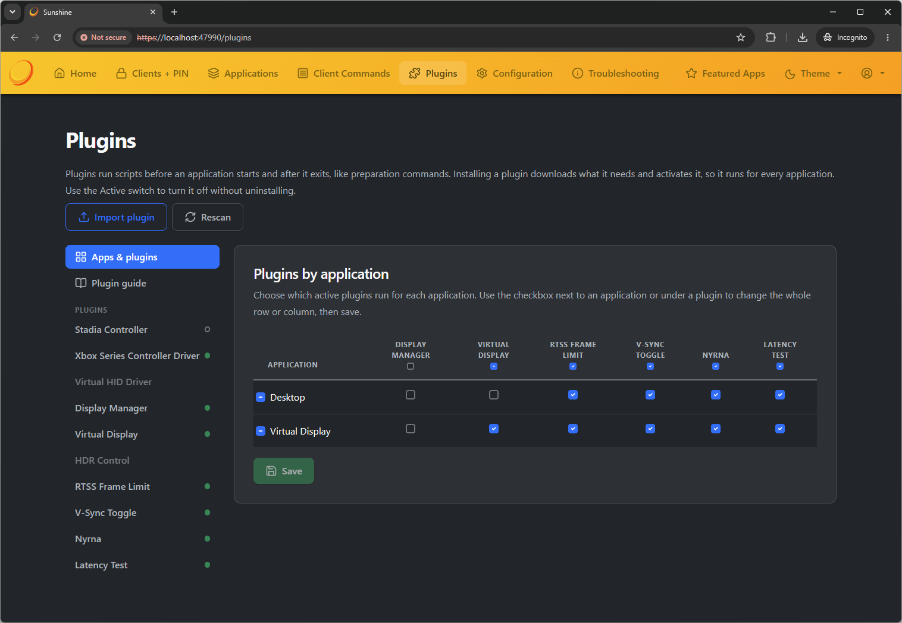
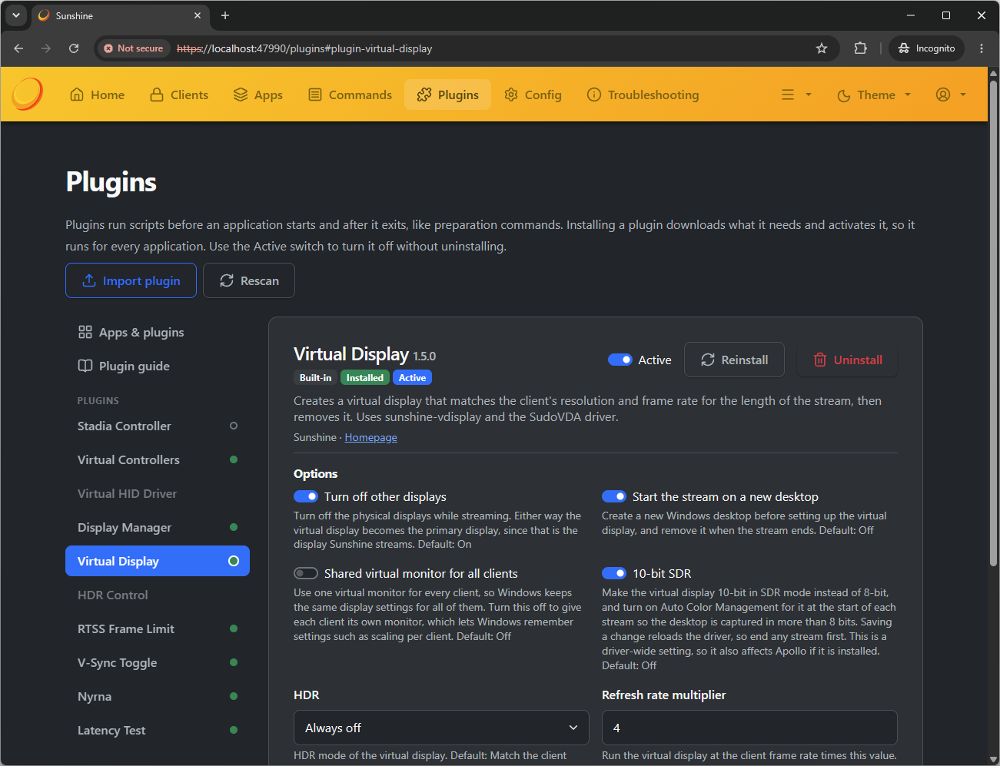
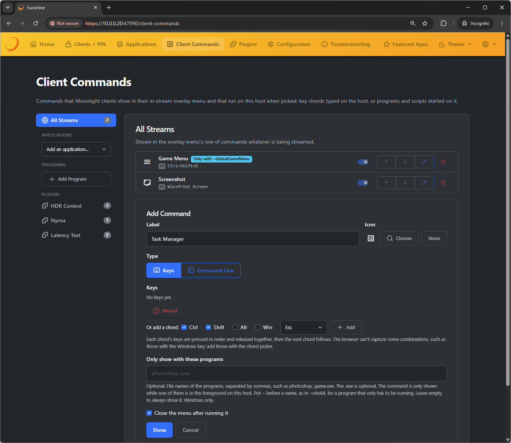
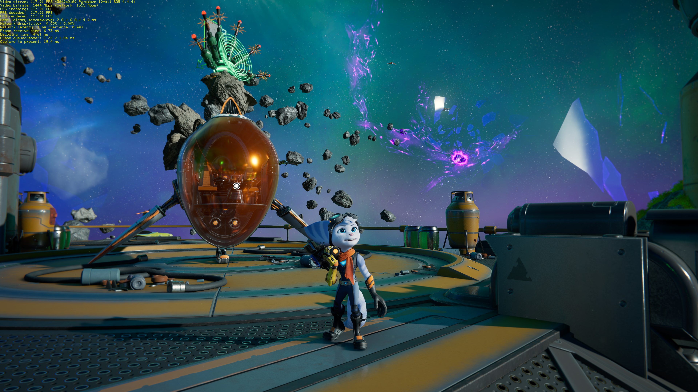

# MoreOrLessSoftware Sunshine

This is a fork of [LizardByte Sunshine](https://github.com/LizardByte/Sunshine), the self-hosted game stream host for Moonlight. The upstream documentation is on [Read the Docs](https://docs.lizardbyte.dev/projects/sunshine).

It works with any Moonlight client, but many features are designed for the MoreOrLessSoftware clients: [Moonlight PC](https://github.com/MoreOrLessSoftware/moonlight-qt) (Windows and Linux) and [Moonlight for Android](https://github.com/MoreOrLessSoftware/moonlight-android). Releases for Windows (an installer and a portable zip) are on the [releases page](https://github.com/MoreOrLessSoftware/Sunshine/releases).

## New In This Fork

### Plugins

Plugins automate the setup you would otherwise do with preparation commands. Each one bundles the scripts that run when a stream starts and stops, a step that downloads what the scripts need, and options you change in the web UI. Windows only. See the [plugin docs](docs/plugins.md).

- Install, activate, configure, reinstall and uninstall plugins from the **Plugins** page. Bundled plugins are active by default and reinstall themselves when Sunshine updates.
- Options can differ per application or per client (the client wins), and the page shows which devices override an option.
- Plugins can add action buttons, a live panel, home page notices and status scripts, and can run scripts when a client resumes or leaves.
- Import your own plugin from a folder or a GitHub URL, and check for updates. A [plugin guide](src_assets/windows/assets/plugins/PLUGIN_GUIDE.md) is included, written for people and for coding agents.

[](https://raw.githubusercontent.com/MoreOrLessSoftware/Sunshine/mlsoft-custom/screenshots/plugins.webp)

Bundled plugins:

- **Virtual Display (using SudoVDA)**: a virtual monitor matching the client's resolution and frame rate, optionally at a multiple of it (the default is 4x), shared or per client, with 10-bit SDR and an option to stream on a new Windows desktop.
- **Display Manager**: sets a physical display to the client's resolution and refresh rate while it streams, and restores your layout afterwards.
- **HDR Control**: sets HDR monitor calibration profiles and HDR mode per-client/per-app, adds a *Toggle HDR* client command.
- **RTSS Frame Limit**: caps games at the client's frame rate through RivaTuner.
- **V-Sync Toggle**: sets the driver's global V-Sync for the stream (NVIDIA and AMD).
- **Nyrna**: a *Suspend* / *Resume* client command, with a notification showing what is suspended.
- **Xbox Series Controller Driver**: light-weight input driver that maps any client controller to an Xbox Series controller on this host.
- **Virtual HID**: manage the optional Virtual HID driver license and status.
- **Stadia Controller**: use a Stadia Controller over Wi-Fi as a virtual Xbox controller, with a live view of its buttons and optional headset audio.
- **Latency Test**: a test pattern for measuring latency and pacing with a phone camera (read more: [ML Latency Analyzer](https://github.com/MoreOrLessSoftware/latency-analyzer))

[](https://raw.githubusercontent.com/MoreOrLessSoftware/Sunshine/mlsoft-custom/screenshots/plugin_virtual_display.webp)

### Client Commands

Buttons that Sunshine adds to a Moonlight client's in-stream overlay menu. Each one types a key combination on the host or starts a program or script. See the [client command docs](docs/client_commands.md).

- Edit them on the **Client Commands** page, for all streams, for one application, or for a group of programs.
- Program groups appear when one of their programs is in the foreground (or, with a `~` before the name, just running).
- Plugins add commands of their own, and you can change their labels, icons and programs.
- Individual commands can be turned on or off. Command lines are told which client and application they run for.

[](https://raw.githubusercontent.com/MoreOrLessSoftware/Sunshine/mlsoft-custom/screenshots/client_commands.webp)

[](https://raw.githubusercontent.com/MoreOrLessSoftware/moonlight-android/mlsoft-x/screenshots/v0.8.0/overlay_menu.png)\
*Example client commands in Moonlight X on Android.*

### Web UI

- Recommendations on the Home page, such as the best AMD encoder settings or the Virtual Display app, applied in one click.
- A **Clients + PIN** page to manage paired devices: rename them in a dialog, search and sort, see when each last connected, and have a client's name filled in when you pair with a PIN.
- Plugin settings for an application or a client, with option choices that a script can supply.
- A list view for the Applications page, and an overview of every application against every plugin.
- The Sunshine version in the page header, and the active encoder and NVENC unit count in the configuration.
- A layout that works on phones.

### Latency and Frame Pacing

- Frames are captured as soon as the desktop presents them, instead of on a fixed timer. The client sees steadier timestamps and less apparent jitter. This allows for native-like VRR frame pacing on the client with minimal frame buffering.  
  > **NOTE**: Because capture isn't tied to the display's refresh rate, you can stream at a higher frame rate than your physical display or dummy HDMI plug supports - for example, 4K at 120 FPS from a 4K/60 Hz display, with proper frame pacing. Use the V-Sync Toggle plugin to turn off v-sync so the game isn't held to the display's refresh rate, and the RTSS Frame Limit plugin to cap it at the stream's frame rate.
- Frames are sent in parts while they encode, with a configurable send rate and finer slices, for NVENC and the AMF encoders. The client can ask for a send rate or opt out of sub-frame slices.  
  **NOTE**: For NVENC, you can use either split-frame encoding or sub-frame encoding - not both at the same time. For cards with 2 encoders, split-frame encoding is likely the better choice.
- When a game renders fewer frames than the stream's frame rate, the bitrate is raised to match, so the stream stays close to the bitrate the client asked for. Repeating frames can be turned off or tuned with `minimum_fps_target`.
- Frame generation sometimes presents frames unevenly. With the **Frame cadence smoothing** setting, the repeating pattern is detected and each frame is stamped where even spacing would put it, so a client that shows frames by their timestamps shows no judder.  
*If you're using MFG Unlocker with a 30-series card, set ```Rtx30FlipMetering=0```*
- Per-frame latency traces: a log, and a CSV of every sent frame for matching against client logs.
- The host answers the client's clock sync requests on the video port.

### AMF Direct Encoding

On AMD GPUs on Windows, AV1 and HEVC are encoded through AMD's AMF directly, instead of through FFmpeg.

- Frames are sent while they encode, as tiles (AV1) or slices (HEVC), set with `amd_av1_tiles` and `amd_hevc_slices`.
- AV1 recovers from lost frames with long-term references instead of an IDR frame.

### PyroWave

Support for [PyroWave](https://github.com/Themaister/pyrowave), an experimental wavelet codec for very low latency at very high bitrates on a wired LAN. Encodes 4:2:0 and 4:4:4 in Vulkan compute on Windows and spends its error correction on the critical packets of each frame. Needs a client that decodes PyroWave, such as MoreOrLessSoftware Moonlight PC.

[](https://raw.githubusercontent.com/MoreOrLessSoftware/Sunshine/mlsoft-custom/screenshots/pyrowave_demo.webp)

### Error Correction

- The client can choose its own FEC percentage, and `fec_percentage = 0` sends none.
- A configurable video send rate.

### Input

- **Xbox Series Controller Driver** (xgpad): a virtual Xbox Series X|S controller that XInput, Windows.Gaming.Input and GameInput see as a real one, with Guide and Share buttons and impulse trigger rumble. It needs no kernel driver. It is an optional installer component that can also be installed from the web UI.
- **Virtual HID**: virtual gamepads without ViGEmBus, which is no longer needed.

### Sessions

- Preparation commands can run when a client resumes a running application or when the last client leaves it.
- The output of do, undo, connect and disconnect scripts is kept and shown in the web UI.

### Building and Releases

- Pushing a `vX.X.X` tag builds a Windows MSI and a portable zip and attaches them to a draft release.
- The version shown names the tag or branch, and the update check can be turned off.

## Documentation

See the [docs](docs) folder, in particular [plugins](docs/plugins.md), [client commands](docs/client_commands.md) and the [configuration reference](docs/configuration.md).

## Building

See the upstream instructions: [docs/building.md](docs/building.md).

## Downloads

[Download the installer or portable zip from releases](https://github.com/MoreOrLessSoftware/Sunshine/releases)

## Credits

This is a fork of [LizardByte Sunshine](https://github.com/LizardByte/Sunshine), created by [Elia Zammuto](https://github.com/loki-47-6F-64) and maintained by [LizardByte](https://github.com/LizardByte) and its contributors. Video encoding with PyroWave uses [PyroWave](https://github.com/Themaister/pyrowave) by Hans-Kristian Arntzen.

The bundled plugins build on these projects:

- [sunshine-vdisplay](https://github.com/Zayrick/sunshine-vdisplay) by Zayrick, the virtual display driver used by Virtual Display.
- [PSVirtualDesktop](https://github.com/MScholtes/PSVirtualDesktop) by Markus Scholtes, which creates the new Windows desktop for Virtual Display and Display Manager.
- [vsync-toggle](https://github.com/xanderfrangos/vsync-toggle) by Xander Frangos, used by V-Sync Toggle on NVIDIA GPUs.
- [Nyrna](https://github.com/Merrit/nyrna) by Merritt Codes, which suspends and resumes games for the Nyrna plugin.
- [Stadiacast](https://github.com/MoreOrLessSoftware/stadiacast), a fork of [jkfran's Stadiacast](https://github.com/jkfran/stadiacast), for Stadia Controller.
- [latency-analyzer](https://github.com/MoreOrLessSoftware/latency-analyzer), the test pattern and analysis tools for Latency Test.
- [libvirtualhid](https://github.com/LizardByte/libvirtualhid) by LizardByte, for Virtual HID.
- [RivaTuner Statistics Server](https://www.guru3d.com/download/rtss-rivatuner-statistics-server-download/) by Unwinder, which RTSS Frame Limit controls (installed separately).
